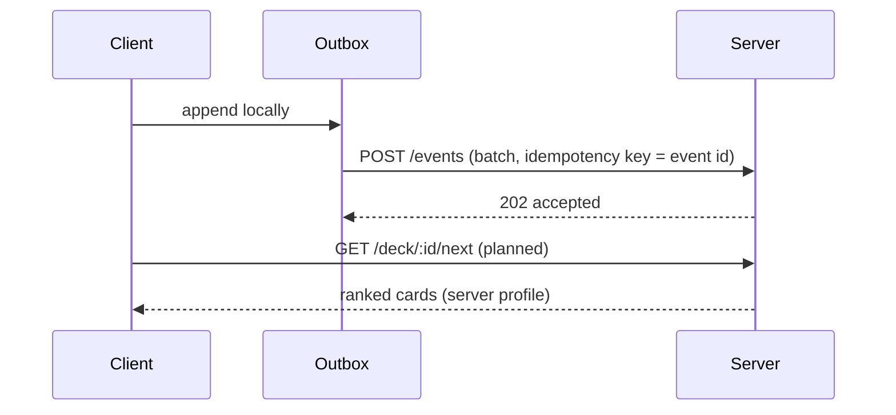

# Self-host the server

The optional server adds multi-device sync and server-side ranking. It is a small
Node HTTP service that implements the same store interfaces as the client, so a
deck behaves identically whether ranking runs in the browser or on the server.

::: warning Milestone M3 in progress
`@swipeline/server` implements health, event append, export and erase. SQLite and
Postgres storage, server-side ranking, collections, webhooks and the OpenAPI
document are planned; the table below marks what actually works.
:::

## Run it

```bash
npx swipeline serve --port 8787 --cors https://app.example.com
```

`serve` currently uses the in-memory event log, so history lasts only as long as
the process. Or wire it up yourself:

```ts
import { MemoryEventStore } from '@swipeline/core'
import { createServer } from '@swipeline/server'

const server = createServer({
  events: new MemoryEventStore(),
  cors: ['https://app.example.com'],
})
const running = await server.listen(8787)
console.log(running.url)
```

## API surface

| Method | Path | Status |
|---|---|---|
| `POST` | `/events` | Implemented — validated, idempotent by event id, body capped |
| `GET` | `/export/:actor?deckId=&since=&until=&afterId=&limit=` | Implemented — JSONL |
| `DELETE` | `/actors/:actor` | Implemented |
| `GET` | `/health` | Implemented |
| `GET` | `/deck/:id/next?actor=…&limit=…` | Planned — needs the item store and ranking |
| `GET` | `/collections/:id` | Planned |
| `GET` | `/openapi.json` | Planned |

`POST /events` accepts an array or `{ "events": [...] }`. Duplicate ids are
dropped by the store, so a client can retry a batch safely.

## Authentication

Swipeline does not implement user accounts. Pass a hook; return `null` to reject
with 401. When the hook is set, a batch may only contain events for the actor it
resolves, so a client cannot write into someone else's history.

```ts
createServer({
  events,
  authenticate: async (request) => {
    const token = request.headers.authorization?.replace('Bearer ', '')
    const claims = await verifyJwt(token)
    return claims ? { actor: claims.sub } : null
  },
})
```

Never trust an `actor` from the request body: the hook is what decides identity,
and the server refuses a mismatch rather than rewriting it.

## Sync model



Events are append-only, so last-write-wins is not needed: duplicates are dropped
by id, and ordering is by ULID. A client that has been offline flushes its outbox
in order.

## Webhooks

Planned with `sinks`. The intended signature is `X-Swipeline-Signature:
t=<unix>,v1=<hmac-sha256(t + "." + body, secret)>`, with receivers rejecting
timestamps older than five minutes. Nothing signs or delivers webhooks yet.

## Operations

| Concern | Guidance |
|---|---|
| Backups | Not applicable to the in-memory store; a durable store arrives with storage |
| Migrations | Planned with SQLite/Postgres |
| Rate limits | Put the server behind a proxy; it does not rate-limit by actor |
| Logs | The server writes no request logs today; add them at your proxy |
| Deletion | `DELETE /actors/:actor` is synchronous and irreversible |
| TLS | Terminate at the proxy; the server speaks plain HTTP |

## Privacy

Running the server means events leave the device. Before you do:

1. Update your privacy notice and consent flow.
2. Decide retention and implement it.
3. Keep the HMAC secret and database credentials out of the client.
4. Read [Local-first and privacy](/concepts/local-first-and-privacy) — the
   sensitive-category guidance applies to what you store server-side.
